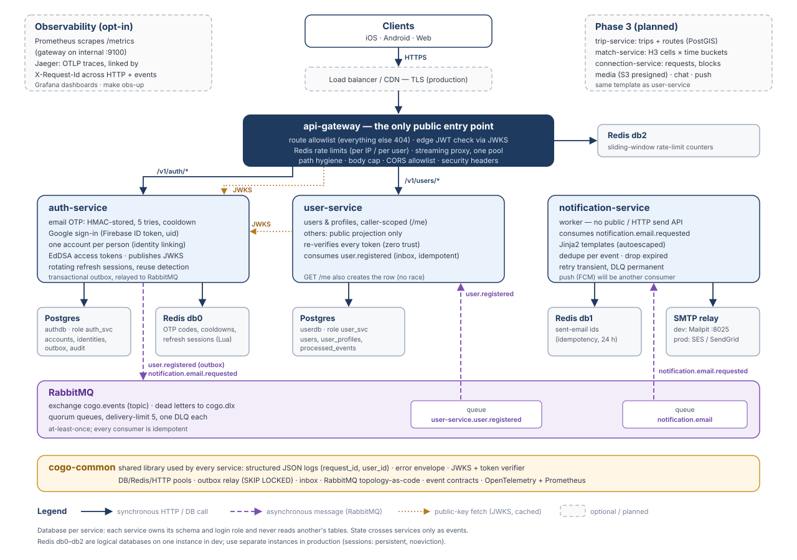
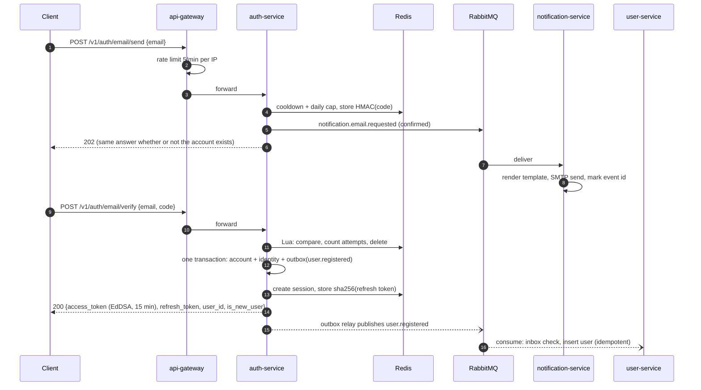
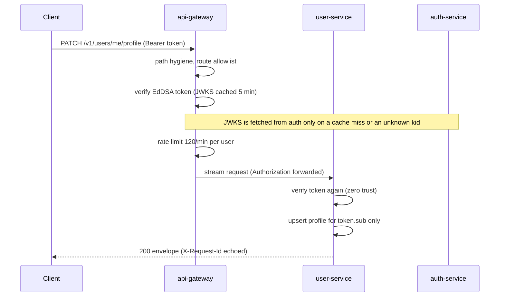
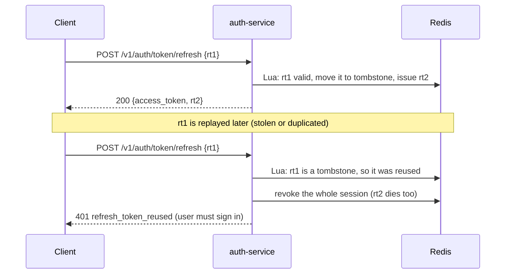
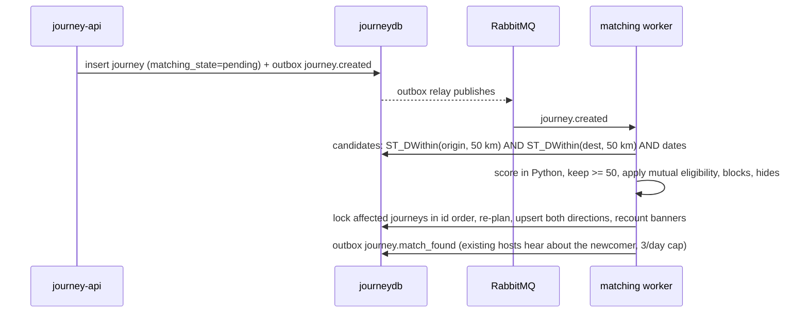

# CoGo backend architecture

CoGo connects people whose travel paths overlap. This document describes how the backend is
built today (Phase 1 through milestone M4; progress and every difference from the build spec are
in [RECON.md](RECON.md)). For running it locally, see [SETUP.md](SETUP.md). For endpoint-level
detail, see the generated contracts in `contracts/openapi/` and `contracts/events/` (the
[API workbook](api/CoGo-API-Reference.xlsx) covers the auth and user core).



The diagram shows the platform core (gateway, auth, user, notification, messaging). The
journey and social services in the table below plug into the same gateway, bus and patterns.

## Components

| Component | Responsibility | Owns | Talks to |
|---|---|---|---|
| **api-gateway** | The only public entry point. It routes an explicit allowlist, checks JWTs at the edge, applies rate limits and streams requests to upstreams. | Redis db2 (rate-limit counters) | auth, user, journey and social services (HTTP); auth JWKS |
| **auth-service** | Identity: email OTP and Google sign-in, account linking, access tokens, refresh sessions | Postgres `authdb` (accounts, identities, session_audit, outbox); Redis db0 (OTP, sessions) | RabbitMQ (publishes) |
| **user-service** | User records and profiles, personality tags, cover photos, media uploads, follower and journey counters | Postgres `userdb` (users, personality_tags, user_cover_photos, media_uploads, block_projection, outbox, processed_events) | RabbitMQ (publishes `user.*`; consumes registrations, follows, journey counts, blocks); object storage (presigned uploads); auth JWKS |
| **journey-service** | Journeys and their lifecycle scheduler, home feed, likes/comments/shares/hides, share pages, Places proxy, and the **matching worker** | Postgres `journeydb` with PostGIS (journeys, journey_matches, engagement tables, user and block projections, outbox, processed_events); Redis db4 (Places cache, scheduler locks, match-push caps) | RabbitMQ (publishes `journey.*`; consumes its own `journey.*`, `user.*`, blocks, moderation); social-service (follow status, internal HTTP); Google Places in production |
| **social-service** | Follows, blocks, reports and auto-hide moderation | Postgres `socialdb` (follows, blocks, reports, moderation_state, user_projection, outbox, processed_events); Redis db5 | RabbitMQ (publishes `social.*`, `safety.*`; consumes `user.*`) |
| **notification-service** | Delivers notifications. Email today, push later | Redis db1 (idempotency keys) | RabbitMQ (consumes); SMTP relay |
| **cogo-common** | Shared infrastructure library used by every service. It holds no domain logic. | — | — |
| **RabbitMQ** | Event and command bus: exchange `cogo.events` (topic) and DLX `cogo.dlx` | one quorum queue + DLQ per consuming service | — |
| **Object storage** | Avatars and cover photos (S3 API; RustFS in dev) | media bucket | Clients upload with presigned PUTs |

## Principles

1. **Database per service.** Each service has its own database and login role, and can't
   connect to another's (Postgres enforces this). No cross-service joins.
2. **State crosses services as messages, not calls.** A producer writes its event in the same
   transaction as its data (*transactional outbox*). A relay publishes it with confirms. Consumers
   are idempotent, because delivery is at-least-once.
3. **The gateway authenticates; services authorise.** Every service re-verifies the access
   token. Identity always comes from the verified token `sub`, never from a client-supplied id.
4. **Stateless services.** Scaling means adding replicas. All shared state lives in Postgres,
   Redis or RabbitMQ, including rate limits and sessions.
5. **No internals in responses.** Every service returns the same `{status, code, message, data,
   error}` envelope. Detail goes to structured logs, keyed by `request_id`.

## Key flows

### Email sign-in (first time)



Google sign-in follows the same path. The only difference is step 9: auth-service verifies the
Firebase ID token against Google's JWKS, and the identity key is the Firebase `uid`. If a
verified email already belongs to an account, the new identity is **linked** to that account
instead of creating a second one.

### Authenticated request



### Refresh rotation and theft detection



## Data ownership

| Service | Tables / keys | Notes |
|---|---|---|
| auth-service | `accounts` (one per person; `id` is the platform user id, UUIDv7), `identities` (UNIQUE provider+subject), `session_audit`, `outbox` | Email OTP and refresh sessions live in Redis db0 under hashed keys, so Redis holds no raw emails or tokens |
| user-service | `users` (one row per person, profile columns included, `version` for projections), `personality_tags`, `user_cover_photos`, `media_uploads`, `block_projection`, `outbox`, `processed_events` | The user row is created from the event or from the first `GET /me`, whichever comes first |
| journey-service | `journeys` (PostGIS points, GiST indexes), `journey_matches` (directional match rows), `journey_likes`, `journey_comments`, `journey_shares`, `hidden_journeys`, `user_projection`, `block_projection`, `outbox`, `processed_events` | Coordinates never leave the service; clients see place names only |
| social-service | `follows`, `blocks`, `reports`, `moderation_state`, `user_projection`, `outbox`, `processed_events` | Source of truth for blocks; other services keep a versioned `block_projection` |
| notification-service | Redis db1 `notif:sent:{event_id}` (24 h) | No database |
| api-gateway | Redis db2 `gw:rl:*` | Rate-limit windows |

Migrations use Alembic per service, with async `env.py` and named constraints. In compose they
run as one-shot `*-migrate` containers before each service starts.

## Messaging

The full catalogue, with a JSON Schema per event, is in `contracts/events/` (generated by
`make contracts`). The families:

| Routing keys | Producer → consumers | Notes |
|---|---|---|
| `user.registered` | auth → user | Written in the account transaction |
| `user.created`, `user.updated` | user → journey, social | Fat snapshots with `version`; consumers upsert projections and ignore older versions |
| `social.followed`, `social.unfollowed` | social → user | Follower counters |
| `social.user_blocked`, `social.user_unblocked` | social → user, journey | Block projections (unblock keeps a tombstone); journey-service also recomputes the pair's matches |
| `safety.content_hidden`, `safety.content_unhidden` | social → journey | Moderation flags on journeys and comments |
| `journey.created`, `journey.updated`, `journey.deleted`, `journey.status_changed` | journey → journey (matching worker), user (counters) | Chat (M5) will also consume them |
| `journey.match_found`, `journey.liked`, `journey.commented`, `journey.reminder_due` | journey → notification (M5) | Published ahead of their consumer |
| `notification.email.requested` | auth (direct, confirmed) → notification | The API returns 503 if publishing fails. The consumer drops expired requests and skips duplicates |

Producers write events with a transactional outbox. The relay uses `FOR UPDATE SKIP LOCKED` and
is safe in every replica, and consumers skip duplicates using `processed_events`.

Every queue is a quorum queue with `x-delivery-limit: 5` and its own `.dlq` bound to `cogo.dlx`:
- **Poison messages** (invalid payloads, permanent SMTP 5xx errors) are rejected straight to the
  DLQ.
- **Transient failures** are retried with backoff, then nacked.

All producers and consumers declare the same topology at startup
(`cogo_common.events.topology`). A routing key that some queue in that topology binds is
published `mandatory`: if no queue accepts it (a lost binding), the publish raises and the outbox
retries it instead of silently dropping it. Keys nobody consumes yet (such as
`journey.match_found` before notification-service subscribes in M5) are published without
`mandatory`, so they don't clog the outbox.

## Security model

- **Tokens:** Ed25519 (EdDSA) access tokens with 15-minute lifetime.
  - Claims: `sub, sid, iss, aud, iat, nbf, exp, jti`; header `kid` (RFC 7638 thumbprint),
    `typ: at+jwt`.
  - Only auth-service holds the private key, mounted as a compose secret. Everyone else verifies
    via JWKS. Algorithms are pinned, which blocks `alg=none` and HS/RS confusion.
- **Sessions:** refresh tokens are opaque, single-use and stored as SHA-256 hashes. Rotation is
  atomic (a Lua script). Replaying a used token revokes the session. Logout and logout-all are
  supported.
- **OTP:**
  - Codes come from a CSPRNG and are stored as HMAC(email:code).
  - 5 attempts per code. A 60 s resend cooldown and a daily cap apply per email; the gateway
    adds a per-IP limit.
  - The send response is identical whether or not an account exists, so it can't be used to
    discover registered emails.
- **Edge:**
  - Allowlisted routes only; internal endpoints (JWKS, health, metrics, `/internal`) are 404 at
    the edge.
  - Raw-path traversal is rejected.
  - Body size is capped while streaming.
  - Spoofable forwarding headers are replaced.
  - Security headers are added on every response, plus HSTS in production.
- **Data:**
  - One Postgres role per service.
  - Containers are non-root, with nothing secret baked into images.
  - Each service gets only the environment variables it needs.
  - Logs mask email addresses and never contain OTP codes or tokens.
- **Supply chain:** dependencies are locked with uv. CI runs ruff, mypy, pytest (with real
  Postgres, Redis and RabbitMQ), pip-audit, Trivy and gitleaks.

## Scalability

| Concern | Approach |
|---|---|
| Horizontal scale | Every service is stateless. Run N replicas behind the load balancer (one uvicorn worker per container; `WEB_CONCURRENCY` if needed) |
| Connections | One pooled HTTP client per process. DB pools are sized per replica (`DB_POOL_SIZE`, `DB_MAX_OVERFLOW`). Keep `replicas × (pool + overflow)` under Postgres `max_connections`, or add PgBouncer (`statement_cache_size=0`) |
| Rate limiting | Redis sliding windows shared by all gateway replicas. Unauthenticated routes fail closed; authenticated routes fail open |
| Slow work | Moved off the request path. OTP email is queued, user provisioning is event-driven, and the OTP request returns in milliseconds |
| Back-pressure | Consumer prefetch 20. Quorum queues with a delivery limit plus DLQs stop poison messages from looping |
| Redis | Dev uses one instance with logical DBs. In production, split sessions (persistent, `noeviction`) from cache and counters. Session Lua scripts assume non-cluster Redis; move to hash-tagged keys before adopting Cluster |
| Observability | JSON logs with `request_id` and `user_id`. Prometheus metrics (HTTP from FastAPI natively, plus broker metrics). OpenTelemetry traces with `traceparent` carried through outbox headers |

## Travel-path matching (M4)

The matching worker lives in journey-service (spec §5.4, §7). A journey matches another when
both ends are close and the dates line up:

```
closeness(d) = 1 if d <= 5 km, 0 if d >= 50 km, linear between
time_score   = max(start proximity (12 h -> 72 h), overlap / shorter duration)
JourneyMatch = round(100 x (0.35 closeness(origins) + 0.35 closeness(destinations) + 0.30 time_score))
```

The weights and thresholds come from config `matching`. The formulas live once, in
`cogo_common.scoring`. Vibe Match (shared tags and age) is computed at read time, relative to
the viewer, so it is never stale.



- **One idempotent operation.** `refresh(journey_ids)` recomputes everything that involves
  those journeys from the current database state, never from the event payload. A deleted,
  cancelled or started journey plans to zero rows, so the same call purges it. Duplicate,
  stale and out-of-order events are therefore harmless.
- **Triggers:** journey created or re-routed, deleted, status changed; block and unblock;
  eligibility-relevant user changes (gender, KYC, account status); moderation hide; and a
  user's own hide and unhide. A scheduler sweep re-runs any journey still `pending` after a
  minute (for example, if its event was dead-lettered).
- **Concurrency:** matching A also rewrites partner B's rows and banner. The worker therefore
  locks every affected journey row in id order before writing. Replicas can't deadlock, and
  banner counts always equal the stored rows. A regression test proves a lost update without
  the lock.
- **Read side:** `GET /v1/journeys/{id}/matches` (host only) is one SQL query over
  `journey_matches`. It re-applies visibility, eligibility, fullness and hides, so a row the
  worker hasn't caught up with yet can't leak. Order is score, then vibe, then start time,
  with keyset cursors and the Home filters.
- **Measured:** at 100k active journeys, a recompute takes 30 ms at the median and 53 ms at
  p95. Eight workers handle about 3,400 journeys per minute (the target is 500), and the
  candidate query runs on a BitmapAnd of the two GiST indexes. See
  [perf/matching.md](perf/matching.md).

**Later.** Matching compares endpoints and dates, not route geometry. If product wants "same
road" matching (for example, Delhi to Manali matching Chandigarh to Manali), add a simplified
route `LineString` per journey and score corridor overlap, with H3 cells as a candidate index.
Chat (M5), eKYC (M6) and admin (M7) follow the milestone plan in RECON.md.

New services copy the user-service template:
- `cogo-common` for logging, errors, the token verifier, DB, outbox/inbox and topology.
- An Alembic `*-migrate` container.
- An explicit gateway route.
- A `QueueSpec` in the shared topology.
