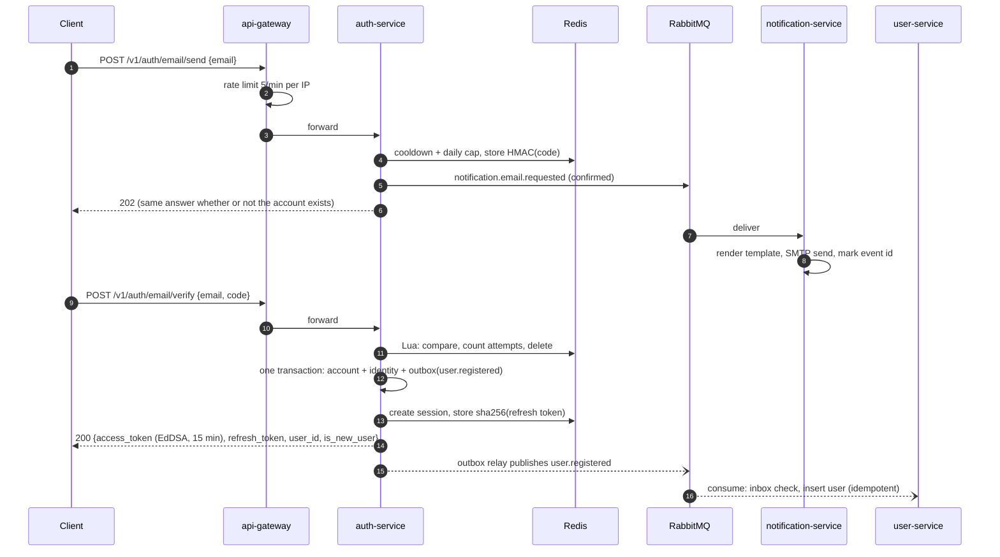
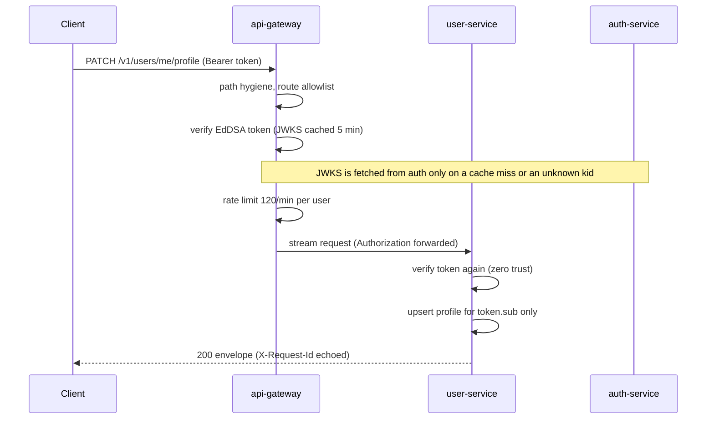
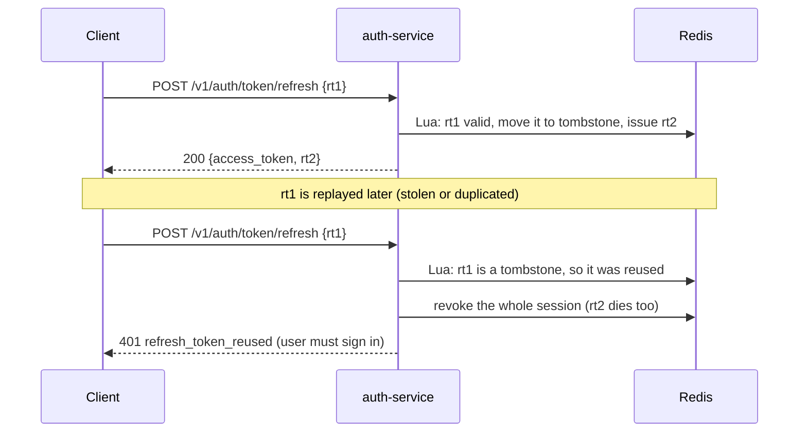

# CoGo backend architecture

CoGo connects people whose travel paths overlap. This document describes how the backend is
built today (Phases 0–2) and where it is going (Phase 3). For running it locally, see
[SETUP.md](SETUP.md). For endpoint-level detail, see
[api/CoGo-API-Reference.xlsx](api/CoGo-API-Reference.xlsx).

## Components

| Component | Responsibility | Owns | Talks to |
|---|---|---|---|
| **api-gateway** | The only public entry point. It routes an explicit allowlist, checks JWTs at the edge, applies rate limits and streams requests to upstreams. | Redis db2 (rate-limit counters) | auth-service, user-service (HTTP); auth JWKS |
| **auth-service** | Identity: email OTP and Google sign-in, account linking, access tokens, refresh sessions | Postgres `authdb` (accounts, identities, session_audit, outbox); Redis db0 (OTP, sessions) | RabbitMQ (publishes) |
| **user-service** | User records and profiles | Postgres `userdb` (users, user_profiles, processed_events) | RabbitMQ (consumes); auth JWKS |
| **notification-service** | Delivers notifications. Email today, push later | Redis db1 (idempotency keys) | RabbitMQ (consumes); SMTP relay |
| **cogo-common** | Shared infrastructure library used by every service. It holds no domain logic. | — | — |
| **RabbitMQ** | Event and command bus: exchange `cogo.events` (topic) and DLX `cogo.dlx` | quorum queues + DLQs | — |

## Principles

1. **Database per service.** Each service has its own database and login role, and can't
   connect to another's (Postgres enforces this). No cross-service joins.
2. **State crosses services as messages, not calls.** A producer writes its event in the same
   transaction as its data (*transactional outbox*). A relay publishes it with confirms. Consumers
   are idempotent, because delivery is at-least-once.
3. **The gateway authenticates; services authorise.** Every service re-verifies the access
   token. Identity always comes from the verified token `sub`, never from a client-supplied id.
4. **Stateless services.** Scaling means adding replicas. All shared state lives in Postgres,
   Redis or RabbitMQ, including rate limits and sessions.
5. **No internals in responses.** Every service returns the same `{status, code, message, data,
   error}` envelope. Detail goes to structured logs, keyed by `request_id`.

## Key flows

### Email sign-in (first time)

Google sign-in follows the same path. The only difference is step 9: auth-service verifies the
Firebase ID token against Google's JWKS, and the identity key is the Firebase `uid`. If a
verified email already belongs to an account, the new identity is **linked** to that account
instead of creating a second one.

### Authenticated request

### Refresh rotation and theft detection

## Data ownership

| Service | Tables / keys | Notes |
|---|---|---|
| auth-service | `accounts` (one per person; `id` is the platform user id, UUIDv7), `identities` (UNIQUE provider+subject), `session_audit`, `outbox` | Email OTP and refresh sessions live in Redis db0 under hashed keys, so Redis holds no raw emails or tokens |
| user-service | `users`, `user_profiles` (PK = user_id, enforcing 1:1), `processed_events` | The user row is created from the event or from the first `GET /me`, whichever comes first |
| notification-service | Redis db1 `notif:sent:{event_id}` (24 h) | No database |
| api-gateway | Redis db2 `gw:rl:*` | Rate-limit windows |

Migrations use Alembic per service, with async `env.py` and named constraints. In compose they
run as one-shot `*-migrate` containers before each service starts.

## Messaging

| Routing key | Kind | Producer → consumer | Reliability |
|---|---|---|---|
| `user.registered` | event | auth (outbox) → user-service | Written in the account transaction. The relay uses `FOR UPDATE SKIP LOCKED` and is safe in every replica. The consumer skips duplicates using `processed_events` |
| `notification.email.requested` | command | auth (direct, confirmed) → notification-service | The API returns 503 if publishing fails. The consumer drops expired requests and skips duplicates |

Every queue is a quorum queue with `x-delivery-limit: 5` and its own `.dlq` bound to `cogo.dlx`:
- **Poison messages** (invalid payloads, permanent SMTP 5xx errors) are rejected straight to the
  DLQ.
- **Transient failures** are retried with backoff, then nacked.

All producers and consumers declare the same topology at startup
(`cogo_common.events.topology`). Publishes are `mandatory`, so a message that no queue accepts
raises an error instead of being silently dropped.

## Security model

- **Tokens:** Ed25519 (EdDSA) access tokens with 15-minute lifetime.
  - Claims: `sub, sid, iss, aud, iat, nbf, exp, jti`; header `kid` (RFC 7638 thumbprint),
    `typ: at+jwt`.
  - Only auth-service holds the private key, mounted as a compose secret. Everyone else verifies
    via JWKS. Algorithms are pinned, which blocks `alg=none` and HS/RS confusion.
- **Sessions:** refresh tokens are opaque, single-use and stored as SHA-256 hashes. Rotation is
  atomic (a Lua script). Replaying a used token revokes the session. Logout and logout-all are
  supported.
- **OTP:**
  - Codes come from a CSPRNG and are stored as HMAC(email:code).
  - 5 attempts per code. A 60 s resend cooldown and a daily cap apply per email; the gateway
    adds a per-IP limit.
  - The send response is identical whether or not an account exists, so it can't be used to
    discover registered emails.
- **Edge:**
  - Allowlisted routes only; internal endpoints (JWKS, health, metrics, `/internal`) are 404 at
    the edge.
  - Raw-path traversal is rejected.
  - Body size is capped while streaming.
  - Spoofable forwarding headers are replaced.
  - Security headers are added on every response, plus HSTS in production.
- **Data:**
  - One Postgres role per service.
  - Containers are non-root, with nothing secret baked into images.
  - Each service gets only the environment variables it needs.
  - Logs mask email addresses and never contain OTP codes or tokens.
- **Supply chain:** dependencies are locked with uv. CI runs ruff, mypy, pytest (with real
  Postgres, Redis and RabbitMQ), pip-audit, Trivy and gitleaks.

## Scalability

| Concern | Approach |
|---|---|
| Horizontal scale | Every service is stateless. Run N replicas behind the load balancer (one uvicorn worker per container; `WEB_CONCURRENCY` if needed) |
| Connections | One pooled HTTP client per process. DB pools are sized per replica (`DB_POOL_SIZE`, `DB_MAX_OVERFLOW`). Keep `replicas × (pool + overflow)` under Postgres `max_connections`, or add PgBouncer (`statement_cache_size=0`) |
| Rate limiting | Redis sliding windows shared by all gateway replicas. Unauthenticated routes fail closed; authenticated routes fail open |
| Slow work | Moved off the request path. OTP email is queued, user provisioning is event-driven, and the OTP request returns in milliseconds |
| Back-pressure | Consumer prefetch 20. Quorum queues with a delivery limit plus DLQs stop poison messages from looping |
| Redis | Dev uses one instance with logical DBs. In production, split sessions (persistent, `noeviction`) from cache and counters. Session Lua scripts assume non-cluster Redis; move to hash-tagged keys before adopting Cluster |
| Observability | JSON logs with `request_id` and `user_id`. Prometheus metrics (HTTP from FastAPI natively, plus broker metrics). OpenTelemetry traces with `traceparent` carried through outbox headers |

## Phase 3: travel-path matching

- **trip-service** stores `trips(user_id, depart_at, arrive_at, mode, visibility)` and a
  `route geography(LineString, 4326)` with a GiST index (the PostGIS image is already in compose).
  It emits `trip.created`, `trip.updated` and `trip.cancelled` through the outbox.
- **match-service** finds matches in two steps:
  1. **Candidate generation:** cover each route with H3 cells (res 7–8) × hourly time buckets,
     and keep an inverted index `cell:bucket → trip_ids`. Each trip costs O(cells in its route),
     not O(all trips).
  2. **Scoring:** rank candidates by overlap ratio, time-window overlap, direction, and social
     filters (blocks, privacy, preferences). Run an exact PostGIS check only on the top N.
     Results are pushed to clients through notification-service.
- **Privacy:** never expose another user's raw route. Snap endpoints to coarse cells, and give
  users per-trip visibility.
- **Also planned:** connection-service (requests, follows, blocks), media-service (S3 presigned
  uploads), chat (WebSocket + Redis pub/sub) and FCM push.

New services copy the user-service template:
- `cogo-common` for logging, errors, the token verifier, DB, outbox/inbox and topology.
- An Alembic `*-migrate` container.
- An explicit gateway route.
- A `QueueSpec` in the shared topology.
